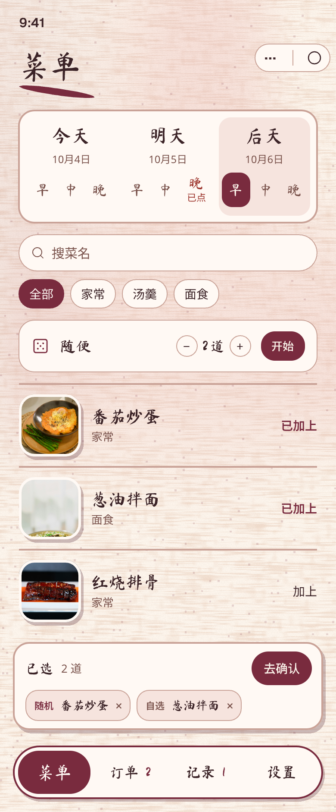
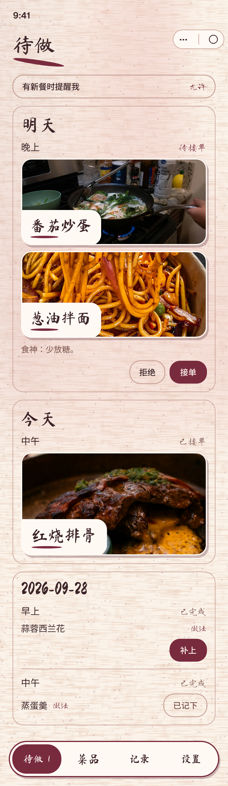
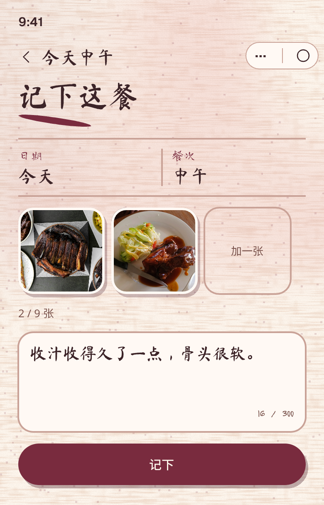

<p align="center">
  
</p>

<h1 align="center">EatEat</h1>

<p align="center">一间只给两个人用的厨房：一个人做饭，一个人点餐。</p>

<p align="center">
  <a href="https://app.pen.dev/s/CTmaggYbSW84Htz7g7M9ClVp5TvDQIpqz0vaoSDf6Ss">设计稿</a>
  ·
  <a href="./blog/index.md">开发手记</a>
  ·
  <a href="./LICENSE">MIT</a>
</p>

EatEat 是一个微信小程序。没有支付，没有配送，也没有陌生人。打开后先选一边：做饭、点餐，或者填对方的邀请码。选完生成一间待加入的厨房，把 6 位邀请码发给对方，剩下的就是点菜和开火。

界面是纸色底和勃艮第红，标题用手写体。菜单、待做、订单和记录都像贴在冰箱上的纸条。

## 界面

| 选一边 | 点餐 | 待做 | 记下这餐 |
| :---: | :---: | :---: | :---: |
|  |  |  |  |

## 两个人各自看到什么

| | 做饭的人 | 点餐的人 |
| --- | --- | --- |
| 首页 | 待做，按用餐时间排 | 菜单，按日期和早中晚排 |
| 底栏 | 待做、菜品、记录、设置 | 菜单、订单、记录、设置 |
| 能做的事 | 写菜、上架、接单或拒绝、记下这一餐 | 搜菜、按分类筛、随机补几道、点 1 到 6 道菜 |
| 记录 | 发布照片或文字 | 可以翻看，不能修改或删除 |

一些具体规则：

- 邀请码 6 位，48 小时有效。换新码后，旧码和已经发出的卡片一起失效。
- 一个厨房固定一位做饭的人、一位点餐的人。默认称呼是「厨神」和「食神」，可以改成 2 到 8 个字。
- 点餐只能选今天、明天、后天；餐次只有早上、中午、晚上。一单 1 到 6 道菜，备注最多 100 个字。
- 没封面的菜不能上架。封面从相册选，或当场拍。分类名 1 到 6 个字，菜名最多 20 个字。
- 做饭的人可以接单或拒绝，拒绝要留一句话；点餐的人取消也要留。留言最多 40 个字。
- 做完之后可以记一笔：最多 9 张照片和 300 字，照片和文字至少留一样。订单和记录会保留当时的菜名和封面，之后改菜、下架、删菜，已经留下的那一餐不变。

## 技术栈

| 层 | 用什么 |
| --- | --- |
| 界面 | Vue 3.4、`<script setup>`、TypeScript |
| 框架 | uni-app 3，目标平台 `mp-weixin` |
| 构建 | Vite 5、pnpm、`@uni-helper/unh` |
| 样式 | UnoCSS 66、`@uni-helper/unocss-preset-uni`，尺寸用 `rpx` |
| 工程 | 文件路由、布局、组件自动注册、`unplugin-auto-import` |
| 质量 | ESLint 9、vue-tsc、Vitest |
| 后端 | uniCloud（阿里云）、云对象 `eat`、Node.js 18 |
| 上传 | `uni-mini-ci` |

项目从 [Vitesse uni-app](https://github.com/uni-helper/vitesse-uni-app) 起步，主要开发目标只有微信小程序。

## 目录

```text
src/
  pages/                 角色选择、邀请绑定、点餐、做饭
  components/            菜单、待做、订单、记录、纸页、底栏、弹窗
  api/                   云对象类型与调用
  composables/           分页、顶部安全区
  utils/                 账号、缓存、主题、格式化
  styles/                主题变量与字体
uniCloud-alipay/
  cloudfunctions/eat/    云对象 eat
  database/              集合 schema 与索引
design/design.pen        Pencil 设计稿
blog/                    开发手记与界面截图
scripts/                 版本号、菜品导入、uniCloud 凭证注入
```

## 本地运行

需要 Node 22（见 `.node-version`）和 pnpm 9.15.4。

1. 安装依赖

   ```bash
   pnpm i
   ```

2. 准备应用标识

   ```bash
   cp manifest.config.example.ts manifest.config.ts
   ```

   填 DCloud AppID 和微信小程序 AppID。`manifest.config.ts` 不提交。

3. 准备 uniCloud 凭证

   ```bash
   cp .env.unicloud.example .env.unicloud.local
   ```

   填服务空间凭证。没填时 `pnpm dev` 仍能编译，但客户端调不到云对象。

4. 准备微信登录密钥

   ```bash
   cp uniCloud-alipay/cloudfunctions/eat/secrets.example.json uniCloud-alipay/cloudfunctions/eat/secrets.local.json
   ```

   填小程序 AppSecret。也可以用环境变量 `WX_APPID`、`WX_SECRET`、`WX_MP_STATE`，说明在 [secrets.md](./uniCloud-alipay/cloudfunctions/eat/secrets.md)。

5. 上传云端

   在 HBuilderX 或 uniCloud 控制台把 `uniCloud-alipay` 里的云对象 `eat` 上传到同一个服务空间，再按 `uniCloud-alipay/database` 里的 schema 和 index 文件建好集合与索引。

6. 启动

   ```bash
   pnpm dev
   ```

   默认构建 `mp-weixin`，产物在 `dist/dev/mp-weixin`。用微信开发者工具导入这个目录，页面验收也在开发者工具里做。

## 常用命令

| 命令 | 做什么 |
| --- | --- |
| `pnpm dev` | 开发构建，默认 `mp-weixin`，产物在 `dist/dev/mp-weixin` |
| `pnpm build` | 生产构建；可追加平台，如 `pnpm build wx` |
| `pnpm type-check` | 用 vue-tsc 做类型检查 |
| `pnpm lint` | ESLint 检查，`pnpm lint:fix` 自动修 |
| `pnpm test` | 用 Vitest 跑单元测试 |
| `pnpm upload:mp-weixin` | 构建、递增 `.minicirc` 版本号、上传微信 |
| `pnpm dishes:import` | 从 `scripts/dishes/*.json5` 批量导入菜品，需要先部署云函数并有已绑定的厨房 |

## 上传与 CI

`pnpm upload:mp-weixin` 会先构建，再把 `.minicirc` 里的版本号加一，然后通过 `uni-mini-ci` 上传。上传密钥放在 `key/` 下，已被 git 忽略；`.minicirc` 的 `weixin.privateKeyPath` 指向它。

仓库有两个 GitHub Actions。`Check` 在 push 和 PR 到 main 时跑 lint、类型检查和构建，覆盖 Node 18、20、22 和 Linux、Windows、macOS。`Upload mp-weixin` 在 main 上构建并上传体验版，需要 secrets `WEIXIN_UPLOAD_PRIVATE_KEY` 和 `UNICLOUD_ENV_LOCAL`，上传后把新版本号回写到 `.minicirc`。

## 开发约定

- 验收看微信开发者工具里的 `mp-weixin`，不看 H5 开发服务器。
- 页面样式尽量写在 `class` 上，用 UnoCSS 和 `rpx`；`<style>` 只留原子类表达不了的部分。
- 文本输入用 `textarea`，单行也一样。
- 改界面前先改 `design/design.pen`，确认后再写页面。

更多说明在 [AGENTS.md](./AGENTS.md)。

## 相关链接

- [开发手记](./blog/index.md)：产品来由、界面和技术栈的长文。
- [设计稿](https://app.pen.dev/s/CTmaggYbSW84Htz7g7M9ClVp5TvDQIpqz0vaoSDf6Ss)：在 Pencil 里打开。
- [GitHub 仓库](https://github.com/Cerrda/eat-eat)

## 许可

[MIT](./LICENSE)
